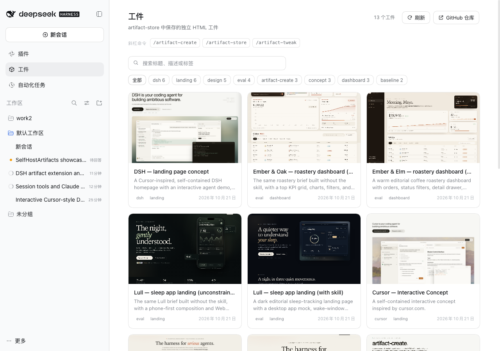
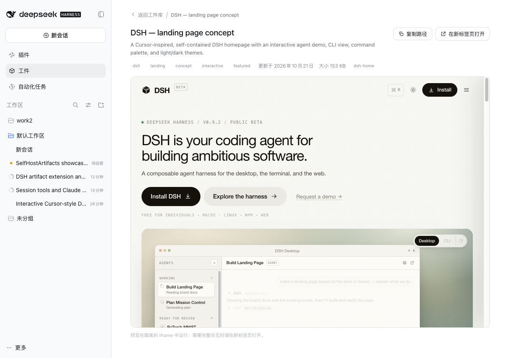
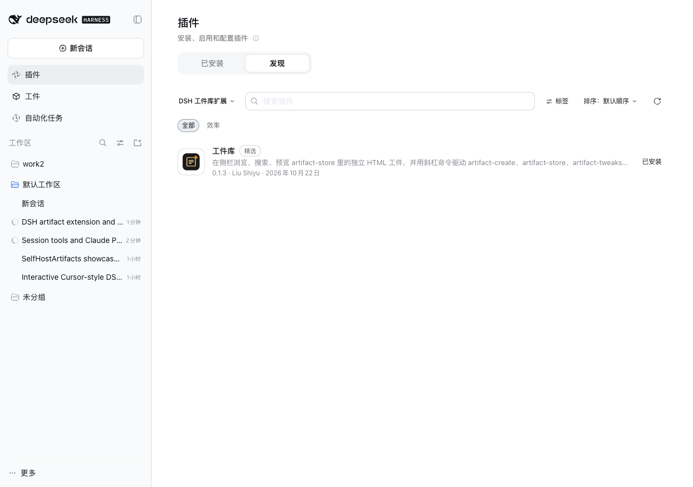

# 工件库 · DSH extension

在 DSH Web 的侧栏加入只读「工件」面板，并提供三条斜杠命令，把 `artifact-create`、`artifact-store`、`artifact-tweaks` 三个技能接进日常使用。





## 功能

- **侧栏「工件」面板**：位于「插件」和「自动化任务」之间（`order: 5`），浏览 `artifact-store` 缓存中的独立 HTML 工件
- **搜索 / 标签筛选**：匹配 slug、标题、描述与标签
- **隔离预览**：在 `sandbox="allow-scripts"` 的 iframe 中运行 `index.html`
- **新标签页打开**：`/dsh-artifacts/view/<slug>` 注入 `<base>`，相对资源也能加载
- **三条命令**：
  - `/artifact-create <描述>` — 启动回合，让 Agent 用 `artifact-create` 技能构建并验证
  - `/artifact-store [list|status|save|load|history|restore]` — `list` 直接返回列表；写入类子命令启动回合调用 `artifact-store` 技能
  - `/artifact-tweak <要求>` — 启动回合，让 Agent 用 `artifact-tweaks` 技能加 Tweaks 面板
- **只读安全边界**：所有路由经过 Host/Origin + 浏览器 Cookie 校验；文件访问做目录穿越与 `realpath` 检查；面板本身不写入 store 或 GitHub

## 安装

要求：DSH `0.2.1-rc.2` 或兼容版本，Node 22+，`dsh web` 可用。

### 从 GitHub 安装

```bash
cd ~/.dsh/profiles/web
pnpm add github:liush2yuxjtu/dsh-artifacts-extension
```

然后把 `@local/dsh-artifacts` 追加到 `package.json` 的 `dsh.profile.bundles`：

```json
{
  "dependencies": {
    "@local/dsh-artifacts": "github:liush2yuxjtu/dsh-artifacts-extension"
  },
  "dsh": {
    "profile": {
      "bundles": [
        "@deepseek-ai/dsh-base",
        "@deepseek-ai/dsh-web-app",
        "@local/dsh-artifacts"
      ]
    }
  }
}
```

```bash
pnpm install
# 重启 dsh web，或让 profile HMR 重组
```

### 从本地 checkout 安装

```bash
cd ~/.dsh/profiles/web
pnpm add link:/absolute/path/to/dsh-artifacts-extension
# 同样把 @local/dsh-artifacts 加入 dsh.profile.bundles
```

### 卸载

```bash
cd ~/.dsh/profiles/web
pnpm remove @local/dsh-artifacts
# 并从 dsh.profile.bundles 移除 @local/dsh-artifacts
```

## 命令

| 命令 | 行为 |
|---|---|
| `/artifact-create <描述>` | 构造冻结的用户消息，交给 Agent 加载 `artifact-create` 技能；空参数返回用法错误 |
| `/artifact-store` | 直接读取 store 缓存并列出工件，不产生模型回合 |
| `/artifact-store status` | 显示仓库、缓存位置、工件数量 |
| `/artifact-store list` | 同 `/artifact-store` |
| `/artifact-store save ...` | 启动回合，让 Agent 用 `artifact-store` 技能保存 |
| `/artifact-store load <slug>` | 启动回合，让 Agent 用 `artifact-store` 技能加载 |
| `/artifact-store history <slug>` | 启动回合，查看提交历史 |
| `/artifact-store restore <slug> <commit>` | 启动回合，恢复旧版本 |
| `/artifact-store help` | 显示用法 |
| `/artifact-tweak <要求>` | 构造冻结的用户消息，交给 Agent 加载 `artifact-tweaks` 技能；空参数返回用法错误 |

命令结果只写入命令生命周期日志，不进入模型历史。

## 面板

| 能力 | 说明 |
|---|---|
| 列表 | 读取 `~/.dsh/cache/artifact-store/<owner>__<repo>/index.json`，按更新时间倒序 |
| 搜索 | 匹配 slug、标题、描述、标签 |
| 标签 | 按出现次数排列，可与搜索叠加 |
| 详情 | 标题、描述、标签、日期、大小、slug |
| 预览 | `srcdoc` + sandbox iframe；完整交互走新标签页 |
| 复制 | 复制 `artifacts/<slug>/index.html` 路径 |
| 命令提示 | 三个命令按钮可点击复制 |

面板是只读的。保存、加载、历史和恢复都由 `/artifact-store` 触发技能完成。运行写入命令后点「刷新」更新面板。

## Host 路由

所有路由都在 `/dsh-artifacts` 下，并经过 `ctx.connection.requestRejection(req)`：

| 路由 | 内容 |
|---|---|
| `GET /dsh-artifacts/list` | 工件元数据 JSON |
| `GET /dsh-artifacts/preview/<slug>` | `preview.png` |
| `GET /dsh-artifacts/html/<slug>` | 原始 `index.html`（用于 `srcdoc`） |
| `GET /dsh-artifacts/view/<slug>` | `index.html` + 注入 `<base>` |
| `GET /dsh-artifacts/asset/<slug>/<path>` | 工件目录内的相对资源 |

无 Cookie 返回 `401`；未知 slug、目录穿越、符号链接逃逸返回 `404`。

## 插件市场索引



仓库发布了格式 1 的市场索引：

```text
https://raw.githubusercontent.com/liush2yuxjtu/dsh-artifacts-extension/main/market/index.json
```

索引内容：

- 插件：`@local/dsh-artifacts` 0.1.3
- 固定到 commit `8e0432d`（可用 `git+https://github.com/liush2yuxjtu/dsh-artifacts-extension.git#<commit>` 安装）
- 分类：`效率`；标签：`精选`
- 中文标题：`工件库`

### 在 DSH 中启用

插件市场是 DSH 的实验性 bundle，默认不挂载。需要两步：

1. 把 `@deepseek-ai/dsh-experimental-plugin-market-bundle` 加入 profile 的 `dsh.profile.bundles`；
2. 配置索引源（任选其一）：
   - 在 **插件 → 发现** 里添加索引 URL；
   - 或在 `cordis.patch.yml` 中写入：

```yaml
- id: plugin-market
  name: "@deepseek-ai/dsh-plugin-market"
  config:
    indexes:
      - https://raw.githubusercontent.com/liush2yuxjtu/dsh-artifacts-extension/main/market/index.json
```

完成后打开 **插件 → 发现**，搜索「工件库」即可看到条目；已安装的 profile 会显示「已安装」，未安装的显示安装按钮。

当前本机 `web` profile 已完成上述配置，备份为 `package.json.bak-market` / `cordis.patch.yml.bak-market`。

## 开发者验证技能

仓库包含一个**不随扩展打包**的 `/verify` 开发技能：

```text
skills/verify-dsh-artifacts/
```

它按 `verify-dot-pi` 的结构组织：claim → surface map → per-surface references → operating rules → PASS/FAIL/BLOCKED/SKIP。

覆盖五个 surface：

1. **extension** — profile 安装、bundle 行、3 条命令、5 条路由、无 Cookie `401`
2. **artifact-create** — 用技能自带 `verify-artifact.mjs` 跑 1440/1024/820/390 + 320 探针
3. **artifact-store** — `status` / `list` / `load` / `history` 只读校验、schema、sha256、计数一致、secret 扫描
4. **artifact-tweaks** — `audit-tweaks.mjs` 全 pass、配对浏览器校验、无 Tweaks 工件负向对照
5. **panel** — CDP 驱动侧栏顺序、卡片、搜索、详情 iframe、复制、320–1280 无溢出、无 console error

### 安装到开发者本机

```bash
ln -s "$PWD/skills/verify-dsh-artifacts" ~/.agents/skills/verify-dsh-artifacts
```

### 运行

```bash
# 静态 + 命令 harness
node skills/verify-dsh-artifacts/scripts/verify.mjs --static-only

# 全量（需要运行中的 dsh web、Cookie、CDP）
DSH_VERIFY_COOKIE='<cookie>' \
  node skills/verify-dsh-artifacts/scripts/verify.mjs --all \
  --probe-320 --tweaks-browser \
  --cdp 'ws://127.0.0.1:<port>/devtools/page/<id>'
```

证据写入 `verify-evidence/<timestamp>/`（已 gitignore），包含 `report.json`、`report.md`、各 surface 原始输出和截图。

> 不要对真实的 `artifact-store` 仓库运行 `save` / `restore --commit`。验证默认只读；写入路径必须使用一次性仓库并显式说明。

## 仓库结构

```text
dsh-artifacts-extension/
  package.json                  # bundle + dsh.client + locale/icon 导出
  cordis.patch.yml              # 插入 id: dsh-artifacts 的 Loader 行
  index.js                      # Host：命令 + 只读路由
  client.js                     # Client：sidebar.panellist / main + 面板 UI
  locale/{zh,en}.json           # 插件列表标题与描述
  icon.svg                      # 插件列表 / 侧栏图标
  docs/preview*.png             # README 截图
  market/index.json             # 格式 1 插件市场索引
  scripts/cdp-check.mjs         # 最小 CDP 驱动，开发用
  skills/verify-dsh-artifacts/  # 开发者 /verify 技能（不打包）
  .github/workflows/ci.yml      # 语法 + 静态验证
  LICENSE                       # MIT
```

## 验证结果

最近一次全量验证（2026-10-22，本地 `dsh web` + CDP）：

| Surface | Verdict | Checks |
|---|---|---|
| extension | PASS | 58/58 |
| artifact-create | PASS | 10/10 |
| artifact-store | PASS | 13/13 |
| artifact-tweaks | PASS | 6/6 |
| panel | PASS | 8/8 |

证据：`verify-evidence/final2/report.md`（本地，gitignored）。

## 已知行为

- 面板读本地缓存，不是实时 GitHub。保存后点「刷新」。
- 斜杠命令目录依赖已有 Client Session；在全新空白页里第一条 `/artifact-*` 可能作为普通提示提交（DSH 的 `/goal` 等 Host 命令同样如此）。进入任意会话后再用。
- 预览 iframe 不带 `allow-same-origin`，与 DSH 自带 HTML 预览一致；依赖 `localStorage` 的工件请在新标签页打开。
- 工件内容来自用户自己的私有仓库，按本地受信内容处理。

## License

MIT © Liu Shiyu
