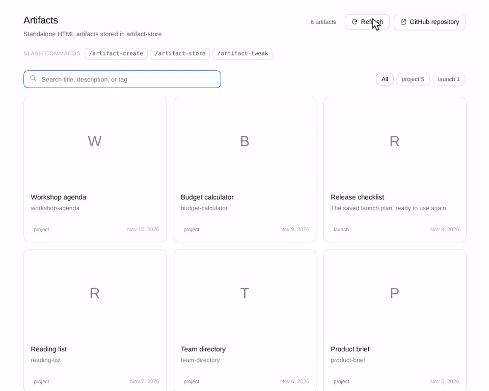
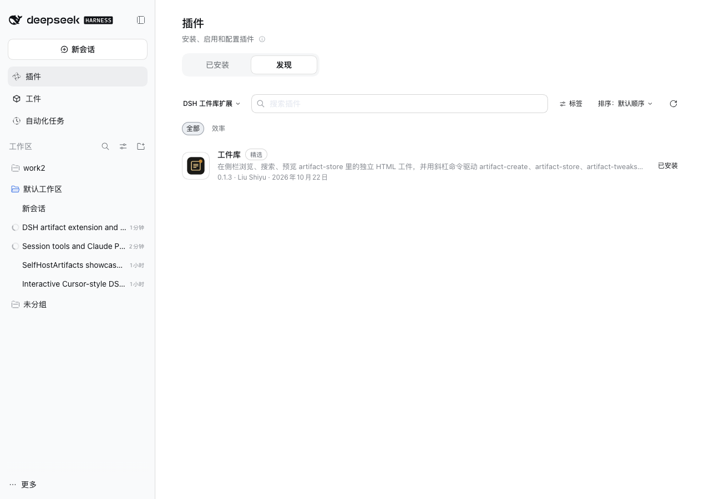
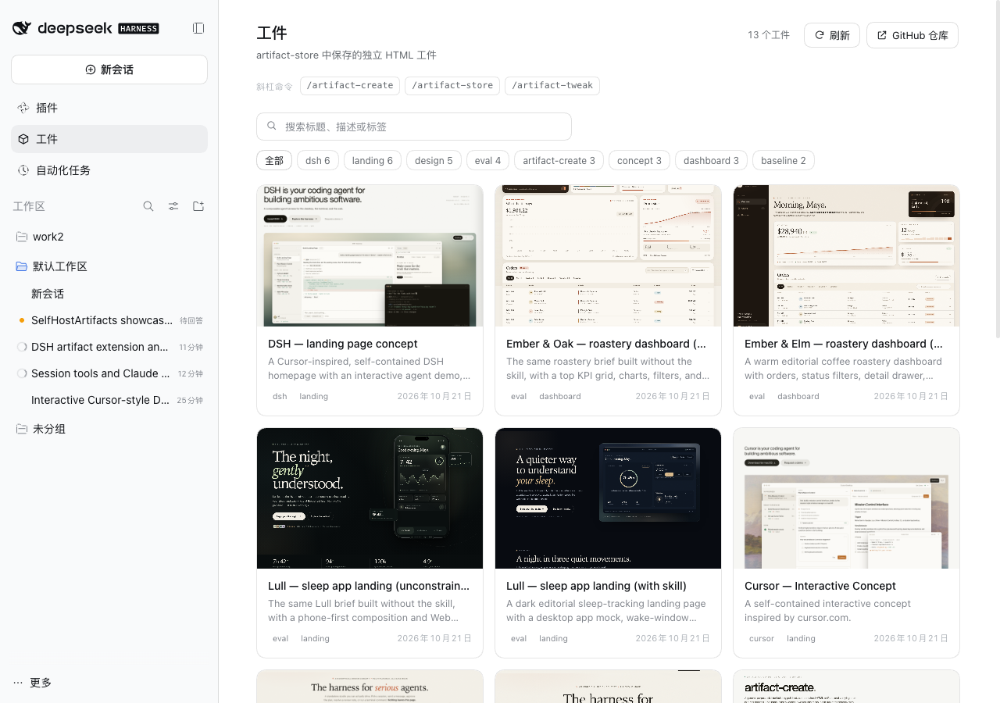
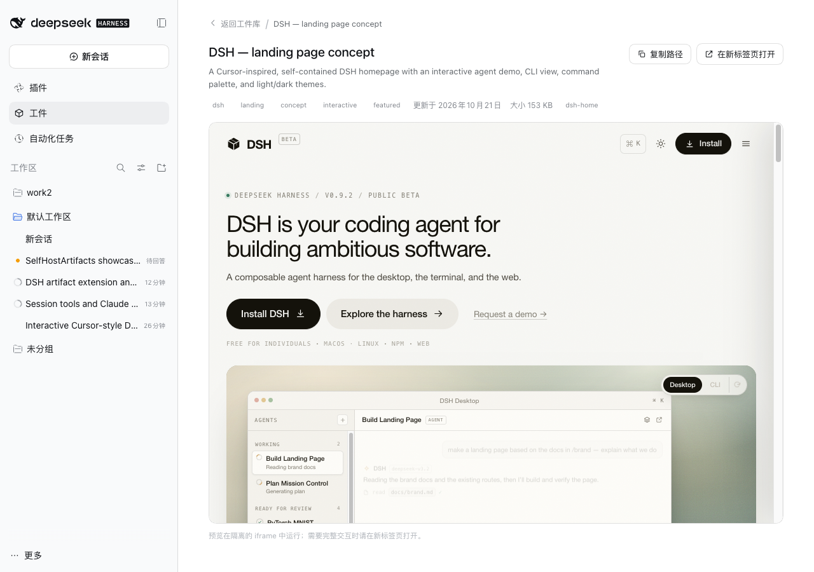

# DeepSeek Harness Artifacts Plugin

[English](README.md) · [简体中文](README.zh-CN.md)

Browse, search, and preview standalone HTML artifacts in the DeepSeek Harness (DSH) Web sidebar. The read-only artifact library connects the `artifact-create`, `artifact-store`, and `artifact-tweaks` skills through three slash commands.

This independent, MIT-licensed community plugin is packaged as `@local/dsh-artifacts` version `0.1.3`. Install it from this GitHub repository. The package is marked `private: true`; these instructions do not assume an npm registry release.

## Find a saved artifact

Find a saved release checklist among six files. Search for it, then open its preview.

[](docs/media/story-20261111/en/story.mp4)

**[Install in a DSH Web profile](#install-in-a-dsh-web-profile)** · [Watch the full 13-second recording](docs/media/story-20261111/en/story.mp4)

This recording uses existing sample HTML files in a local DSH build. The preview is 960px wide; open the video for a larger view on small screens. [Recording source and independent silent review](docs/media/story-20261111/README.md).

## What the plugin does

- Adds the **Artifacts** panel between **Plugins** and **Automation tasks** in the sidebar, with `order: 5`.
- Reads the local `artifact-store` cache. Search matches the artifact slug, title, description, and tags. Tag filters combine with search.
- Shows artifact details, a preview, and a button to copy `artifacts/<slug>/index.html`.
- Previews `index.html` in an iframe with `sandbox="allow-scripts"`. Open an artifact in a new tab for interactions that require `localStorage`.
- Opens `/dsh-artifacts/view/<slug>` with an injected `<base>` so relative assets load.
- Starts the relevant skill through `/artifact-create`, `/artifact-store`, and `/artifact-tweak`.

The panel itself does not write to the store or GitHub. Save, load, history, and restore operations run through the `artifact-store` skill. Click **Refresh** after a write command updates the cache.

## Install in a DSH Web profile

The declared requirements are DSH `>=0.2.1-rc.2`, Node.js `>=22`, and a working `dsh web` installation. The original installation instructions target the `web` profile. A declared version range does not establish runtime compatibility with every later DSH version.

Install from GitHub:

```bash
cd ~/.dsh/profiles/web
pnpm add github:liush2yuxjtu/dsh-artifacts-extension
```

Append `@local/dsh-artifacts` to `dsh.profile.bundles` in that profile's `package.json`. Keep the profile's existing dependencies and bundles. The relevant entries are:

```json
{
  "dependencies": {
    "@local/dsh-artifacts": "github:liush2yuxjtu/dsh-artifacts-extension"
  },
  "dsh": {
    "profile": {
      "bundles": [
        "@deepseek-ai/dsh-base",
        "@deepseek-ai/dsh-web-app",
        "@local/dsh-artifacts"
      ]
    }
  }
}
```

Then install the profile dependencies:

```bash
pnpm install
```

Restart `dsh web`, or let profile HMR recompose the profile. The panel uses the store configured in `~/.dsh/artifact-store.json`. Configure it through the `artifact-store` skill's `init` flow before browsing artifacts.

For a local checkout:

```bash
cd ~/.dsh/profiles/web
pnpm add link:/absolute/path/to/dsh-artifacts-extension
```

Add the same `@local/dsh-artifacts` bundle entry. To uninstall:

```bash
cd ~/.dsh/profiles/web
pnpm remove @local/dsh-artifacts
```

Remove `@local/dsh-artifacts` from `dsh.profile.bundles` too.

## Slash commands

The `artifact-create`, `artifact-store`, and `artifact-tweaks` skills must be available to the agent. The extension fronts those skills; it does not package them.

| Command | Behavior |
| --- | --- |
| `/artifact-create <description>` | Queues an immutable user message asking the agent to load `artifact-create`, build the artifact, and verify it. Empty input returns a usage error. |
| `/artifact-store` | Lists artifacts from the local cache without starting a model turn. |
| `/artifact-store status` | Shows the repository, cache location, and artifact count. |
| `/artifact-store list` | Lists the cached artifacts. |
| `/artifact-store save ...` | Starts a turn for the `artifact-store` skill to save an artifact. |
| `/artifact-store load <slug>` | Starts a turn for the skill to load an artifact. |
| `/artifact-store history <slug>` | Starts a turn to inspect its version history. |
| `/artifact-store restore <slug> <commit>` | Starts a turn to restore an older version. |
| `/artifact-store help` | Shows command usage. |
| `/artifact-tweak <request>` | Queues an immutable user message asking the agent to load `artifact-tweaks` and add a Tweaks panel. Empty input returns a usage error. |

Command results are written to command lifecycle logs, not model history. Commands that queue follow-up messages start a turn by design.

## Storage and security

The list reads `~/.dsh/cache/artifact-store/<owner>__<repo>/index.json` and sorts artifacts by update time. Artifact details include the title, description, tags, dates, size, and slug.

Host routes live under `/dsh-artifacts`. Each route calls `ctx.connection.requestRejection(req)` for Host, Origin, and browser Cookie checks. File access checks paths and `realpath` boundaries.

| Route | Response |
| --- | --- |
| `GET /dsh-artifacts/list` | Artifact metadata JSON. |
| `GET /dsh-artifacts/preview/<slug>` | `preview.png`. |
| `GET /dsh-artifacts/html/<slug>` | Raw `index.html` for the iframe's `srcdoc`. |
| `GET /dsh-artifacts/view/<slug>` | `index.html` with an injected `<base>`. |
| `GET /dsh-artifacts/asset/<slug>/<path>` | A relative resource inside the artifact directory. |

A request without the Cookie returns `401`. Unknown slugs, directory traversal, and symlink escapes return `404`. The preview iframe has no `allow-same-origin`, matching DSH's HTML preview behavior. Artifacts come from the user's own private store and are treated as locally trusted content.

## Plugin market index



The repository includes a [format-1 market index](market/index.json):

```text
https://raw.githubusercontent.com/liush2yuxjtu/dsh-artifacts-extension/main/market/index.json
```

The index describes `@local/dsh-artifacts` `0.1.3`, pinned to [commit `8e0432d`](https://github.com/liush2yuxjtu/dsh-artifacts-extension/commit/8e0432dd2e96a0124def186da3ac7743652b15bc). Its category is **Productivity**, its maintainer-defined label is **Featured**, and its Chinese title is **工件库**. That label is not an independent endorsement.

DSH's experimental plugin market bundle is not loaded by default. Add `@deepseek-ai/dsh-experimental-plugin-market-bundle` to the profile's `dsh.profile.bundles`. Then add the index URL in **Plugins → Discover**, or configure it in `cordis.patch.yml`:

```yaml
- id: plugin-market
  name: "@deepseek-ai/dsh-plugin-market"
  config:
    indexes:
      - https://raw.githubusercontent.com/liush2yuxjtu/dsh-artifacts-extension/main/market/index.json
```

Open **Plugins → Discover** and search for **工件库**. The original October 2026 maintainer record states that this configuration worked in its local `web` profile. It does not establish the state of another installation.

## Troubleshooting

| Symptom | Supported action or limit |
| --- | --- |
| The panel is empty or reports a missing store. | Configure `~/.dsh/artifact-store.json` through the `artifact-store` skill's `init` flow. The panel reads the local cache. |
| A newly saved artifact does not appear. | Click **Refresh** after the skill updates the cache. The panel is not a live GitHub view. |
| The first slash command on a blank page becomes a normal prompt. | Enter an existing session, then use the command. The command catalog depends on an active Client Session. |
| An artifact needs `localStorage`. | Open the artifact in a new tab. The isolated preview iframe does not include `allow-same-origin`. |

## Developer verification

The developer-only [verification skill](skills/verify-dsh-artifacts/SKILL.md) is not shipped in the extension package. It checks the extension shell, `artifact-create`, `artifact-store`, `artifact-tweaks`, and the sidebar panel separately. The [evidence guide](skills/verify-dsh-artifacts/references/05-evidence.md) defines verdicts and release requirements.

To make the skill available locally:

```bash
ln -s "$PWD/skills/verify-dsh-artifacts" ~/.agents/skills/verify-dsh-artifacts
```

Run the static and command-handler harness:

```bash
node skills/verify-dsh-artifacts/scripts/verify.mjs --static-only
```

The full verification needs a running DSH Web process, an authorized browser Cookie, CDP, and the artifact skills:

```bash
DSH_VERIFY_COOKIE='<cookie>' \
  node skills/verify-dsh-artifacts/scripts/verify.mjs --all \
  --probe-320 --tweaks-browser \
  --cdp 'ws://127.0.0.1:<port>/devtools/page/<id>'
```

Evidence is written to ignored `verify-evidence/<timestamp>/`, including JSON, Markdown, raw output, and screenshots. Keep credentials and private artifact bodies out of reports. Do not run `save` or `restore --commit` against the real artifact store during verification. Use an explicitly approved disposable repository for store writes.

The existing README records these historical results from October 22, 2026, using local `dsh web` and CDP:

| Surface | Recorded verdict | Recorded checks |
| --- | --- | --- |
| Extension | PASS | 58/58 |
| `artifact-create` | PASS | 10/10 |
| `artifact-store` | PASS | 13/13 |
| `artifact-tweaks` | PASS | 6/6 |
| Panel | PASS | 8/8 |

The cited original report, `verify-evidence/final2/report.md`, was local and ignored by Git. Its raw evidence is not published here. These counts are a historical maintainer record, not a fresh runtime acceptance result or proof of real model execution. Use the published verifier to repeat the checks.

## Historical screenshots

These Chinese screenshots come from the October 2026 DSH verification record. The current English recording is above.





## Repository contents

| Path | Purpose |
| --- | --- |
| [package.json](package.json) | Bundle manifest, client entry, locale exports, and compatibility declarations. |
| [cordis.patch.yml](cordis.patch.yml) | Loader row with `id: dsh-artifacts`. |
| [index.js](index.js) | Host commands and read-only routes. |
| [client.js](client.js) | Sidebar panel registration and UI. |
| [locale](locale) | English and Chinese plugin-list text. |
| [market/index.json](market/index.json) | Format-1 market index. |
| [scripts/cdp-check.mjs](scripts/cdp-check.mjs) | Development CDP helper. |
| [skills/verify-dsh-artifacts](skills/verify-dsh-artifacts) | Developer verification workflow and scripts. |
| [.github/workflows/ci.yml](.github/workflows/ci.yml) | Syntax and static checks. |

## Related plugin

[DSH Sidebar History](https://liush2yuxjtu.github.io/dsh-sidebar-history/) shows TODO progress and the latest saved reply in session history cards. This plugin provides the read-only artifact library panel. They address different tasks.

## License

[MIT](LICENSE) © Liu Shiyu. This is not an official DeepSeek product.
