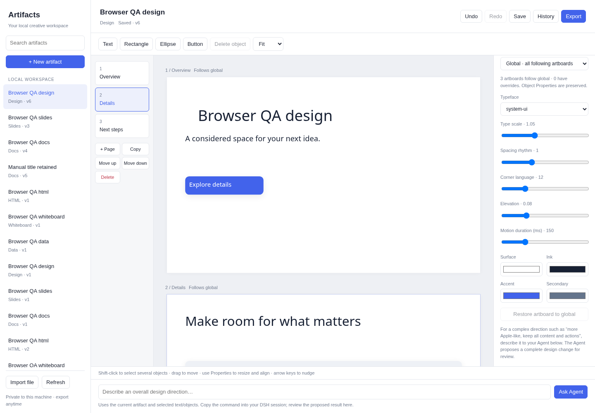
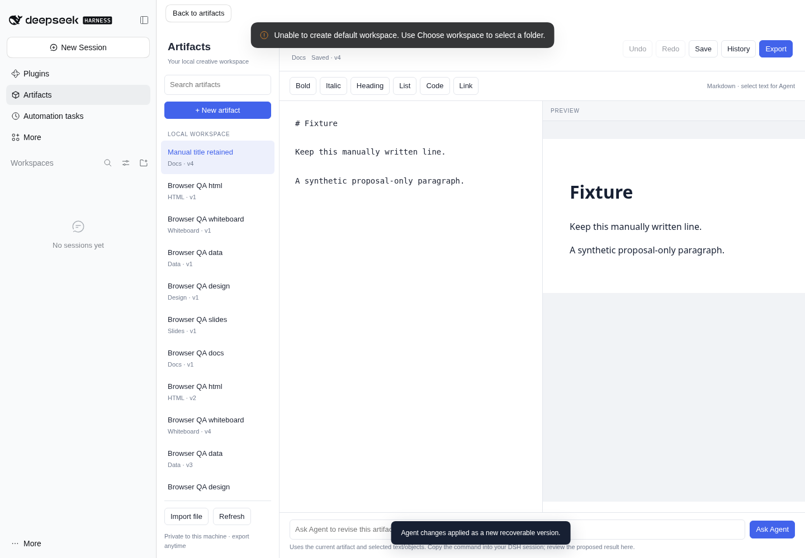

# Workbench candidate verification

The native workbench is implemented and reviewable. **Full PRD acceptance remains BLOCKED** on live DeepSeek/DSH execution and the natural-language three-artboard design task. This candidate has no release tag, deployment, or claim of completing all nine PRD checks.

Verification used a packaged installation in a disposable **real DSH 0.2.2-rc.1** Web profile, Node 24.22.1, Chromium 156.0.8078.79, and Python Playwright. The installed runtime files were compared byte-for-byte with this checkout. Sources are pinned in [source hashes](evidence/workbench-20261115/source-hashes.json), relative to baseline `9826d31d7838a468e54881d11e4f5f3970d29c29`.

| Surface | Result | Evidence |
| --- | --- | --- |
| Native storage, concurrency, recovery, proposal CLI, source validation, OOXML and resource embedding | PASS 18/18 | `npm test`; [test output](evidence/workbench-20261115/node-tests.txt) |
| Unchanged legacy manifest/command/route verifier | PASS 46/46 | [static output](evidence/workbench-20261115/static-verification.txt) |
| Unchanged legacy HTTP verifier against real DSH, six synthetic HTML files | PASS 12/12 | [HTTP output](evidence/workbench-20261115/http-verification.txt) |
| Native editor browser flows | PASS 13 grouped checks | [browser report](evidence/workbench-20261115/browser-report.json) |
| Files opened with independent document/image/XML/ZIP readers; source files reimported through UI | PASS 36 files and all six source types | [export report](evidence/workbench-20261115/exports-report.json) · [actual files ZIP](evidence/workbench-20261115/exports.zip) |
| Proposal review/apply in the real DSH shell, concurrent manual title retained, parent waits for save | PASS 4 checks, synthetic producer, **modelCalls=0** | [proposal report](evidence/workbench-20261115/proposal-report.json) |
| Real model and natural-language overall redesign | BLOCKED, not started | [live report](evidence/workbench-20261115/live-agent-report.json) |
| Native OS print dialog | BLOCKED on available browser environment | Headless Chromium suppresses the dialog; shared desktop startup failed. Actual PDF files were generated by Chromium printToPDF from the workbench's passive print document. |

The browser checks cover Docs save/reload/diff/restore and undo/redo; Slides editing, coordinates and page order; Design dragging, Properties, coordinated theme previews, apply/cancel and artboard follow/overrides; Data editing, chart settings and filters that retain source rows; Whiteboard grouping, connections, movement and negative bounds; and interactive HTML with visible runtime errors. All six editors were checked at 1440px desktop and 390px/320px mobile widths, including source identity after switching artifacts. Dark mode and native app runtime errors were checked.

DOCX and PPTX were opened with `python-docx` and `python-pptx`; their content is editable text/shapes. PNG was opened with Pillow, SVG with an XML parser, ZIP with CRC validation, CSV with its standard parser, and PDF with `pypdf`. PDF page counts were Docs 1, Slides 2, Design 3, Data 1, Whiteboard 1, HTML 1. The HTML error-handling fixture deliberately contains `Synthetic preview failure`; exports retain that synthetic source rather than silently fixing it.





## Remaining acceptance

- An existing authorized DeepSeek credential was recovered and retained only in an ignored private file with mode 0600. The current execution environment allows package-manager domains and rejects the tunnel to `api.deepseek.com` with **403 Forbidden**, before API authentication. This is not an invalid-key verdict. No new key was created, and no credential was placed in source, prompts, screenshots or evidence.
- `tests/live-agent.py` provides the bounded real-model continuation: official API authentication, real DSH headless execution of the exact pinned request prompts, Docs preservation, and an overall design proposal across three artboards. Browser review/application and visual assessment must follow a real completed model run. Its current preflight returns BLOCKED and does not start a model turn.
- Manual global Tweaks are verified. The specific “more Apple-like” model-driven redesign and its visual coherence remain unverified. It is not a canned keyword preset.
- The original Mac mini still returns connector 429; its old task/worktree remains unknown. This isolated candidate does not overwrite it.
- The unchanged verifier's external artifact-create/store/tweaks skill surfaces were not certified by these native editor checks. Historical HTML recordings do not certify this candidate. Release remains gated on complete applicable runtime acceptance.

## Repeat

```sh
npm test
npm run verify:legacy
python3 tests/workbench-browser.py --url http://127.0.0.1:3100 \
  --storage-state /private/browser-state.json --out /tmp/workbench-browser
python3 tests/export-files.py --storage-state /private/browser-state.json \
  --artifacts /tmp/workbench-browser/report.json --out /tmp/workbench-exports
python3 tests/proposal-browser.py --storage-state /private/browser-state.json \
  --workspace /absolute/disposable/workspace
python3 tests/live-agent.py --dsh-bin /absolute/path/to/dsh \
  --workspace /absolute/disposable/workspace --key-file /private/deepseek-api-key
```

Browser/export checks require development-only Python Playwright, python-docx, python-pptx, Pillow and pypdf. Production has no new runtime dependencies. Keep authentication state and raw DSH session events private.
